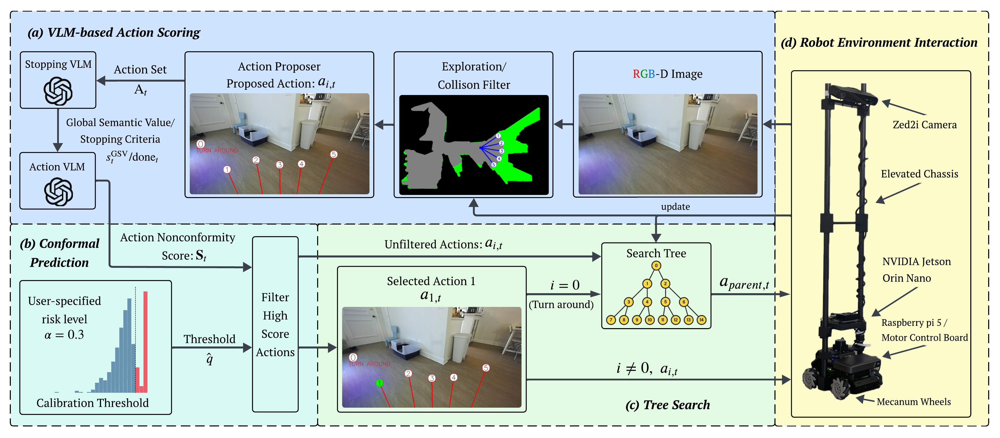

# CPNAV

**CPNAV** is a **Conformal Prediction–augmented Navigation** framework for object-goal search in unseen indoor environments. It uses RGB-D observations to propose collision-free actions, scores them with a vision-language model, and applies conformal prediction to filter unreliable decisions before executing actions through a tree-search policy with backtracking.



## Installation

Setup has three steps: create the conda environment, add your OpenAI API key, and set up the datasets.

### Step 1: Create the Conda Environment

Navigate to the directory you want to install the project:

```bash
conda env create -f environment.yml
conda activate CPnav
```

This installs all dependencies, including `habitat-sim`.

### Step 2: Set Up the OpenAI API Key

CPNAV uses the OpenAI API for VLM-based action scoring and goal checking.

Create a `.env` file in the root `CPnav` directory:

```bash
touch .env
```

Open the `.env` file and add your OpenAI API key:

```bash
OPENAI_API_KEY=your_api_key_here
```

For example:

```bash
OPENAI_API_KEY=sk-...
```

Do not include spaces around the `=` sign. Do not commit your `.env` file to GitHub (it is already listed in `.gitignore`).

### Step 3: Set Up the Datasets

Follow the dataset setup in [DATASET.md](DATASET.md). It covers downloading the
HM3D and MP3D scenes and ObjectNav episodes and placing them under `data/`.

Once done, your project folder should look like this:

```text
CPnav/
├── .env                          # OpenAI API key (Step 2)
├── config/                       # experiment configs (HM3D, MP3D, ablations)
├── CPnav/                        # source code
├── scripts/                      # offline / online / batch runners
├── data/                         # datasets (Step 3, see DATASET.md)
│   ├── versioned_data/
│   │   └── hm3d-0.2/hm3d/        # HM3D scenes
│   └── datasets/
│       ├── objectnav_hm3d_v2/    # HM3D ObjectNav episodes
│       ├── scene_datasets/mp3d/  # MP3D scenes (MP3D only)
│       └── objectnav/mp3d/v1/    # MP3D ObjectNav episodes (MP3D only)
├── environment.yml
├── run.sh
└── README.md
```

## Usage

This repository follows the workflow from the CPNav paper: first
run offline calibration/search to collect calibration scores, then run the
online implementation with the selected conformal threshold. The scores
gathered offline are bounded with the conformal prediction bound using a
human-specified risk threshold, and the resulting threshold is used by the
online policy. All commands should be run from the root `CPnav` directory after
activating the conda environment:

```bash
conda activate CPnav
```

### Command 1: Run Offline Calibration for One Episode

Use `scripts/run_offline.py` to run one offline calibration/search episode. This
records the online trajectory first, then refines the explored tree offline and
saves the offline score and best path under the log directory.

```bash
python scripts/run_offline.py \
  --config config/CPnav_5_nano_131.yaml \
  --log_dir logs/offline_single \
  --episode 100
```

Key arguments:

1. `--config`: Path to the experiment configuration file.
2. `--log_dir`: Directory where logs, images, JSON files, and summaries are saved.
3. `--episode`: Episode index to run.

### Command 2: Run Online Implementation for One Episode

Use `scripts/run_online.py` to run the online CPNav policy. Pass the calibrated
threshold from the offline stage with `--threshold`.

```bash
python scripts/run_online.py \
  --config config/CPnav_5_nano_131.yaml \
  --log_dir logs/online_single \
  --episode 100 \
  --threshold 0.059 \
  --mode cp_nav
```

Key arguments:

1. `--threshold`: Calibrated score threshold used by `cp_nav` mode, gathered from the offline calibration results after applying the conformal prediction bound.
2. `--mode`: Online method to run. Options are `cp_nav`, `simple_set`, `prompt_set`, and `ensemble_set`.
3. `--alpha`: Prediction-set threshold used by `simple_set` and `ensemble_set`.

To accelerate simulation, batch running is also available and is the recommended
way to run offline calibration or online evaluation across multiple episodes.

### Command 3: Batch Run Offline Calibration

Use `scripts/batch_run_offline.py` to run offline calibration on many randomly
sampled episodes in parallel.

```bash
python scripts/batch_run_offline.py \
  --config config/CPnav_5_nano_131.yaml \
  --batch_name offline_calibration \
  --n_exp 300 \
  --max_jobs 10 \
  --seed 42
```

The batch output is saved to `logs/<batch_name>/`. Each episode writes its own
run directory, and terminal logs are saved under `logs/<batch_name>/terminal/`.

### Command 4: Batch Run Online Implementation

Use `scripts/batch_run_online.py` to evaluate online navigation on many randomly
sampled episodes in parallel.

```bash
python scripts/batch_run_online.py \
  --config config/CPnav_5_nano_131.yaml \
  --batch_name online_cp_nav \
  --n_exp 100 \
  --max_jobs 15 \
  --seed 100 \
  --threshold 0.059 \
  --mode cp_nav
```

The online batch runner uses the same online arguments as `run_online.py`,
including `--threshold`, `--mode`, and `--alpha`.

## Method Summary

CPNAV uses a calibrated decision-making pipeline for object-goal navigation.

### Step 1: Action Proposal

Candidate motion primitives are generated from RGB-D observations while enforcing collision safety. The agent uses depth information to identify navigable regions and proposes feasible motion directions.

### Step 2: VLM Scoring

A vision-language model scores each candidate action based on semantic relevance to the target object. These scores estimate which actions are more likely to move the agent toward the goal.

### Step 3: Tree Search

The agent maintains a search tree during exploration. If a branch becomes unpromising or all admissible actions are exhausted, the agent performs local or global backtracking to continue searching from a previous state.

### Step 4: Conformal Prediction

Offline calibration produces a threshold that filters low-confidence actions during online deployment. This helps reduce overconfident but unreliable VLM decisions.

### Step 5: Deployment

During deployment, the calibrated safety set determines which actions are admissible for execution. The agent selects the highest-scoring admissible action and uses backtracking when no reliable action is available.

## Notes

1. Run all commands from the root `CPnav` directory unless stated otherwise.
2. Make sure `OPENAI_API_KEY` is set in the `.env` file before running VLM-based experiments.
3. Make sure the scene and episode files match the `data/` layout in [DATASET.md](DATASET.md).
4. Use `conda activate CPnav` before running scripts.
5. Do not commit `.env` or any private API keys to GitHub.
